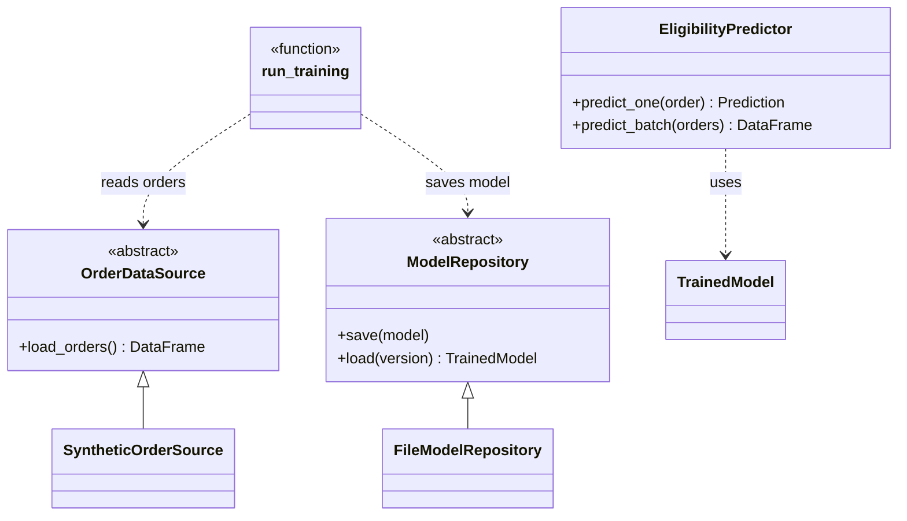

# Express Delivery Eligibility

Predicts whether an order can be delivered express (same day), as a decision aid alongside business rules.

This project turns an experimental Jupyter notebook into a production-ready Python application. It is the practical work for the course *Industrialisation de l'IA dans le cloud* (YNOV Toulouse, M2 Data & IA).

## Problem

| | |
|---|---|
| Task | Binary classification |
| Target | `express_eligible` (1 = eligible, 0 = not eligible) |
| Model | Logistic regression (scikit-learn pipeline) |
| Data | Synthetic orders in the dev environment |

Features used by the model:

- **Order:** `hour`, `day_of_week`, `weekend`, `order_value_eur`, `weight_kg`, `customer_type`
- **Logistics:** `distance_km`, `delivery_zone`, `carrier_capacity`, `weather`
- **Warehouse:** `stock_available`, `preparation_time_min`

## Getting started

Requirements: Python 3.11+.

```bash
python -m venv .venv
source .venv/bin/activate
pip install -r requirements.txt        # application
pip install -r requirements-dev.txt    # + tests and notebook tools
```

## Usage

All commands run from the project root.

```bash
python -m src train                                         # train and save model MODEL_VERSION
python -m src predict examples/order.json                   # one order -> JSON result
python -m src predict-batch examples/orders.csv out.csv     # CSV of orders -> CSV with predictions
python -m pytest                                            # run the tests
```

Example output of `predict`:

```json
{
  "express_eligible": true,
  "decision": "oui",
  "probability": 0.9377,
  "model_version": "1.0.0",
  "prediction_timestamp": "2026-10-07T06:44:49.815481+00:00"
}
```

## Configuration

Settings come from environment variables (see `src/config.py`), so each environment can differ without code changes.

| Variable | Default | Meaning |
|---|---|---|
| `APP_ENV` | `dev` | Selects the implementations in `src/factory.py` |
| `ARTIFACTS_DIR` | `<project>/artifacts` | Where model versions are stored |
| `MODEL_VERSION` | `1.0.0` | Version to train (must be new) or to load |
| `DECISION_THRESHOLD` | `0.5` | Probability from which an order is eligible |
| `RANDOM_STATE` | `42` | Seed for data generation, split and model |

## Project structure

```
.
├── src/
│   ├── __main__.py                   # entry point: python -m src
│   ├── cli.py                        # commands train / predict / predict-batch
│   ├── config.py                     # settings from environment variables
│   ├── factory.py                    # picks the implementation for each abstraction
│   ├── abstractions/
│   │   ├── model_repository.py       # ModelRepository (ABC)
│   │   └── order_data_source.py      # OrderDataSource (ABC)
│   ├── core/
│   │   ├── domain.py                 # TrainedModel, Prediction
│   │   ├── features.py               # feature lists and preprocessing
│   │   ├── data_quality.py           # validation and cleaning
│   │   ├── training.py               # pipeline, training, metrics
│   │   └── predictor.py              # EligibilityPredictor (single + batch)
│   └── infrastructure/
│       └── dev/
│           ├── synthetic_orders.py       # SyntheticOrderSource
│           └── file_model_repository.py  # FileModelRepository
├── tests/
├── examples/                         # sample inputs for predict / predict-batch
├── docs/adr/                         # architecture decision records
└── notebooks/                        # original experiment (reference only)
```

## Architecture

Business code (`core/`) depends only on abstractions. The environment-specific classes live in `infrastructure/`, and `factory.py` is the only place that connects the two (dependency inversion, the "D" in SOLID).



Decisions are recorded in `docs/adr/`:

- [ADR-0000](docs/adr/0000-model-artifact-storage.md): model artifacts in a local directory, one folder per version
- [ADR-0001](docs/adr/0001-order-data-source.md): training data source abstracted per environment
- [ADR-0002](docs/adr/0002-notebook-scope.md): which notebook code goes into the application

## Status

- [x] Experimental notebook
- [x] Project structure
- [x] Notebook logic moved into `src/`
- [x] Model repository (abstraction + local file implementation)
- [x] Tests
- [ ] Production data source and environment
- [ ] Prediction API
- [ ] MLflow tracking
- [ ] CI/CD and deployment

## Limitations

- The dataset is synthetic; performance on real data may differ.
- The model is a decision aid and must not replace business rules.
- Input values are only checked for presence at prediction time; range checks will come with the API.
