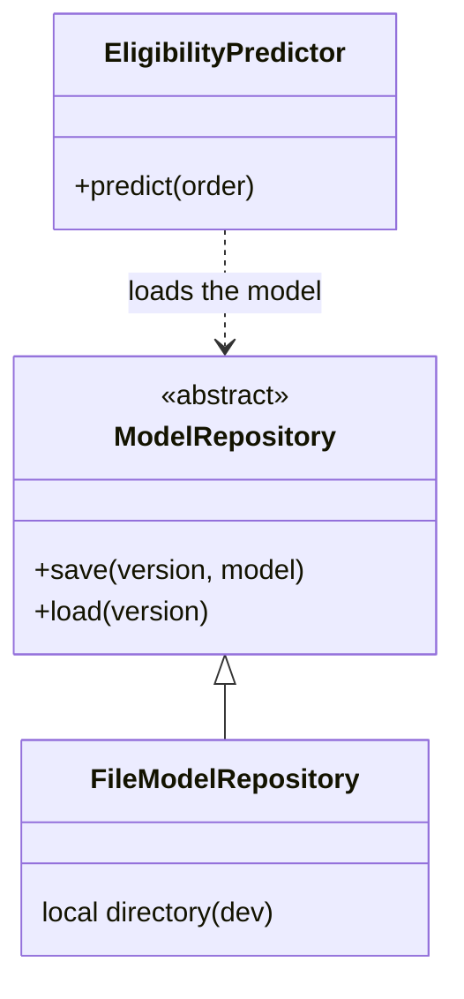

# Express Delivery Eligibility

Predicts whether an order can be delivered express (same day), as a decision aid alongside business rules.

This project turns an experimental Jupyter notebook into a production-ready Python application. It is the practical work for the course *Industrialisation de l'IA dans le cloud* (YNOV Toulouse, M2 Data & IA).

## Problem

| | |
|---|---|
| Task | Binary classification |
| Target | `express_eligible` (1 = eligible, 0 = not eligible) |
| Model | Logistic regression (scikit-learn pipeline) |
| Data | Synthetic orders generated in the notebook (no external source) |

Features used by the model:

- **Order:** `hour`, `day_of_week`, `weekend`, `order_value_eur`, `weight_kg`, `customer_type`
- **Logistics:** `distance_km`, `delivery_zone`, `carrier_capacity`, `weather`
- **Warehouse:** `stock_available`, `preparation_time_min`

## Project structure

```
.
├── notebooks/
│   └── project_test_v1_final_final2.ipynb   # original experiment (reference)
├── src/
│   ├── config.py                            # settings: paths, threshold, model version
│   ├── abstractions/                        # interfaces (abstract base classes)
│   ├── core/
│   │   ├── data_quality.py                  # input data validation
│   │   ├── domain.py                        # Order and Prediction data types
│   │   ├── features.py                      # cleaning and feature lists
│   │   └── predictor.py                     # eligibility prediction
│   └── infrastructure/
│       └── dev/                             # dev implementations (local files)
├── tests/
└── docs/adr/                                # architecture decision records
```

## Architecture

The code follows the dependency inversion principle (the "D" in SOLID): business code depends on an abstraction, and each environment provides its own implementation.



Model artifacts are stored in a local directory for now (see ADR-0000). A model registry can replace it later by adding a new implementation under `infrastructure/`, without changing the business code.

## Getting started

Requirements: Python 3.11+.

```bash
python -m venv .venv
source .venv/bin/activate
pip install pandas numpy scikit-learn joblib mlflow
```

To run the original experiment, also install `jupyter matplotlib seaborn` and open the notebook in `notebooks/`.

Generated files (`artifacts/`, `mlruns/`) are not tracked by git.

## Status

- [x] Experimental notebook
- [x] Project structure
- [ ] Move notebook logic into `src/`
- [ ] Model repository (abstraction + local file implementation)
- [ ] Tests
- [ ] Prediction API
- [ ] CI/CD and deployment

## Limitations

- The dataset is synthetic; performance on real data may differ.
- The model is a decision aid and must not replace business rules.
